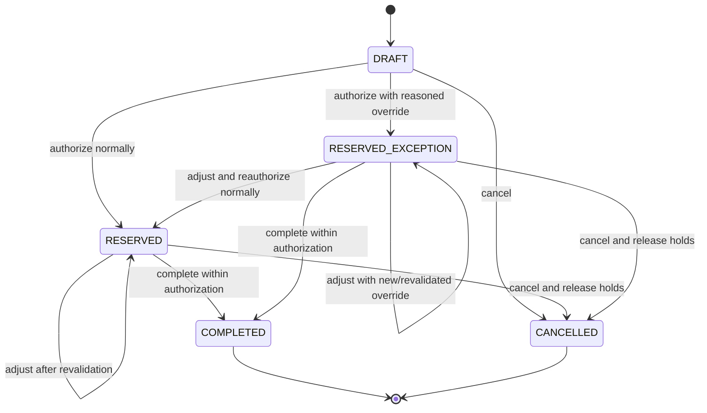
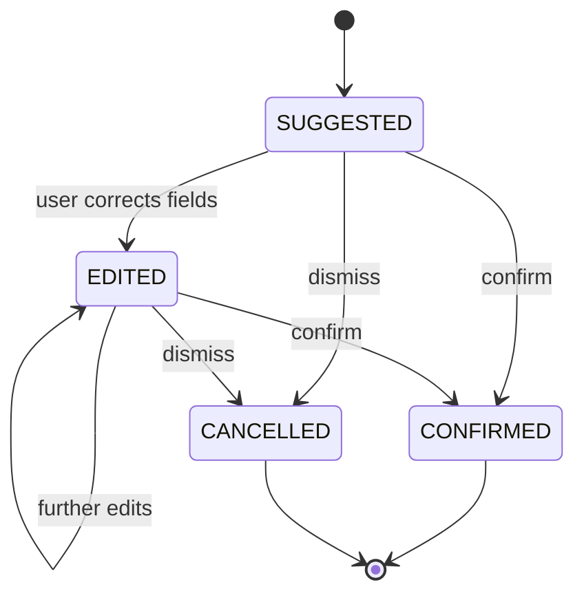

# State Transitions — Household Envelope Budgeting

This is the normative companion to `POSTING_MATRIX.md`. It defines transaction/reservation lifecycle behavior independently from the database or UI implementation.

## 1. Do not collapse independent state dimensions

The implementation should represent three separate concepts:

1. **Record lifecycle** — whether a plan/suggestion is a draft, reservation, or committed event.
2. **Authorization outcome** — normal authorization, emergency override, or not authorized.
3. **Budget resolution** — resolved, underfunded, or awaiting review after a real-world transaction.

For example, a real card purchase entered after the fact may be a `COMMITTED` event, have authorization outcome `NOT_PREAUTHORIZED`, and budget resolution `UNDERFUNDED`. These are not contradictory.

## 2. Planned purchase state machine

### State definitions

- `DRAFT`: no posting, no reservation, freely editable.
- `RESERVED`: normal authorization passed; envelope and, for debit/cash, account reservations exist.
- `RESERVED_EXCEPTION`: a reasoned emergency override passed all non-envelope checks; envelope shortfall is visible, and applicable reservations exist.
- `COMPLETED`: the final purchase is posted exactly once and reservations are released/consumed atomically.
- `CANCELLED`: no purchase was posted; all active reservations are released. The plan and authorization audit remain available.

### Transition contract

| Command | Allowed source state | Preconditions | Atomic result |
|---|---|---|---|
| Edit draft | `DRAFT` | Valid fields; same household | Update draft only |
| Authorize normally | `DRAFT` | Envelope spendable funds and required account funds suffice; payment method valid | Create reservation(s), set `RESERVED`, audit normal authorization |
| Authorize override | `DRAFT` | Reason required; all non-envelope constraints pass | Create reservation(s), set `RESERVED_EXCEPTION`, audit actor/reason/shortfall |
| Adjust reserved plan | `RESERVED`, `RESERVED_EXCEPTION` | Recheck changed amount/category/account; any added shortfall reauthorized | Adjust/release/recreate reservations atomically and update authorization record |
| Complete | `RESERVED`, `RESERVED_EXCEPTION` | Final amount within authorized amount; idempotency valid; recheck any mutable external constraints | Post account/liability and budget events; consume/release reservations; set `COMPLETED` atomically |
| Cancel | `DRAFT`, `RESERVED`, `RESERVED_EXCEPTION` | Not completed | Release any reservations; set `CANCELLED`; no financial postings |
| Complete cancelled plan | `CANCELLED` | Never allowed | Reject; create a new plan instead |
| Edit/cancel completed purchase | `COMPLETED` | Never in place | Reject; use linked reversal/correction or genuine refund event |

Final amount lower than reserved: release the excess. Final amount higher than authorized: reject and require an authorization/reservation adjustment before completion. A planned debit/cash purchase cannot reserve more than available source-account funds. Override never bypasses that constraint.

## 3. Transaction lifecycle

Committed financial events are immutable. Do not change a posted transaction in place to represent a refund, reversal, or correction.

- `COMMITTED`: original postings exist.
- `PARTIALLY_REVERSED`: a linked reversal has compensated only part of the reversible amount.
- `FULLY_REVERSED`: linked compensating events reverse the full reversible effect.

These may be derived display states from original posting amount and linked reversal amounts. A refund is a separate new event and must not be mislabeled as a reversal.

### Correction transitions

- Metadata correction: append an audit event; postings unchanged.
- Category correction: compensate the original budget-category postings, then add the corrected budget postings; account posting unchanged.
- Amount/source correction: compensate the original account and budget postings, then post corrected account/budget effects.
- Duplicate or invalid committed transaction: append compensating postings; preserve original plus reason and links.
- Actual refund: append refund event linked to original, capped by remaining refundable amount.

Where feasible, reversal and replacement should commit atomically. If the implementation permits a multi-step correction workflow, it must expose an explicit correction-in-progress state and must not present a partially corrected budget as final.

## 4. Suggestion lifecycle

For future notification ingestion, and for any noncommitted user-entered suggestion:

A suggestion/draft has no financial postings and no reservations. On confirmation:

- If it is an already-completed real-world purchase, record the factual transaction through the same posting implementation; if underfunded, flag it for budget resolution rather than discarding it.
- If it is a planned purchase not yet completed, send it through the planned-purchase authorization/reservation state machine; confirmation of details alone must not bypass purchase approval.
- If required data is ambiguous (e.g., multiple plausible amounts), keep it in suggestion state and ask the user to correct it.
- Cancellation suppresses that suggestion from the active inbox. Preserve enough source fingerprint/status to avoid recreating it on every sync, without treating identical merchant/amount pairs as guaranteed duplicates.

## 5. Error semantics

Reject the command with no partial domain mutation when:

- source state does not permit the transition;
- the envelope/account is not in the same household or has been archived/disabled in a way that prevents new posting;
- normal funding checks fail;
- an override reason is missing;
- a reservation does not match the current authorization;
- final amount exceeds authorization;
- a refund exceeds refundable remainder;
- a reversal exceeds reversible remainder;
- idempotency key is reused with a different logical payload;
- concurrency validation fails;
- payment/account/currency constraints fail.

Actual external transactions are not rejected solely because no app authorization exists. They are recorded truthfully and flagged as unresolved if necessary. Unknown/ambiguous notifications remain suggestions and are not committed as guessed financial facts.

## 6. Cross-cutting invariants

1. At every committed state: `A = R + sum(E[i])`.
2. At every envelope: `S[i] = E[i] - Qe[i]`.
3. At each eligible cash account: spendable balance equals posted balance minus active account reservations and recognized holds.
4. A reservation is never counted as posted spending.
5. `COMPLETED` occurs at most once per plan/idempotency key.
6. `CANCELLED` plans have no active reservations.
7. No correction/refund/reversal silently destroys original history.
8. Failed operations leave balances and lifecycle state unchanged, apart from a separate security/attempt log if used.
9. Budget resolution state does not rewrite the factual transaction lifecycle.
10. Every override remains attributable to actor, reason, timestamp, and the exact amount it authorized.
